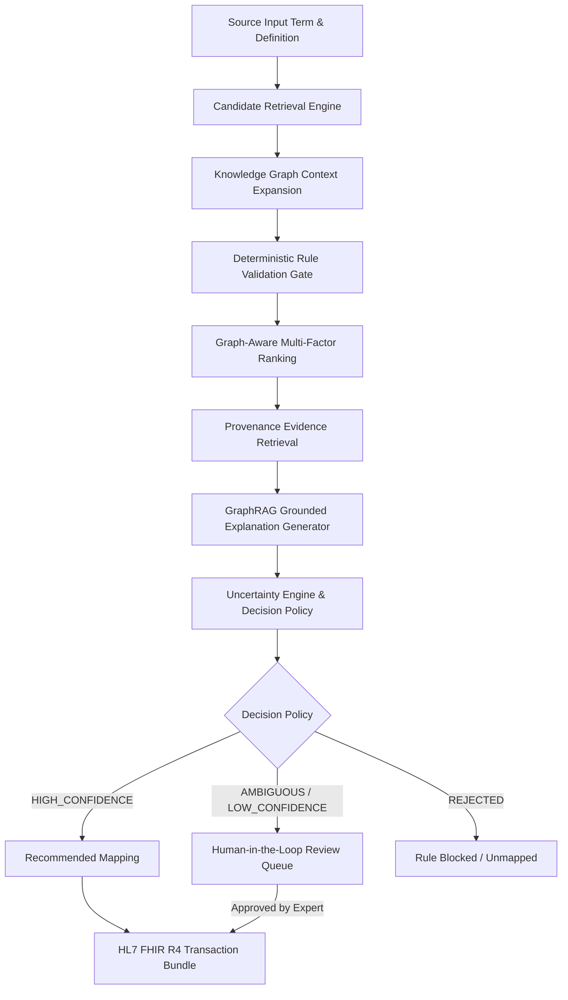

# Research Methodology: Context-Aware, Evidence-Grounded Ayurveda-to-ICD-11 Terminology Mapping

**System:** ClinBridge AI  
**Focus Area:** Healthcare Interoperability, Clinical Natural Language Processing, Knowledge Graphs & GraphRAG  

---

## 1. Problem Formulation

Bridging traditional medical vocabularies (such as the National Ayurveda Morbidity Codes / NAMASTE) with modern international standards like WHO ICD-11 (Biomedicine & TM2 Chapter 26) is challenging due to:
1. **Semantic Divergence**: Traditional disease etiologies (dosha derangements, Agni, Ama) lack 1:1 lexical equivalents in Western biomedicine.
2. **Granularity Mismatches**: A single Ayurvedic syndrome often encompasses multiple symptoms and sub-types that map to separate ICD-11 entities.
3. **Hallucination Risk**: Unconstrained Large Language Models frequently invent non-existent code numbers or inaccurate cross-paradigm translations.

ClinBridge AI formulates this as a multi-stage, evidence-grounded decision process combining:
1. **Multi-Factor Candidate Retrieval & Graph-Aware Ranking**
2. **Deterministic Rule Gating**
3. **GraphRAG Evidence Retrieval & Grounding**
4. **Multi-Signal Uncertainty Evaluation**

---

## 2. Multi-Stage Pipeline Architecture

---

## 3. Mathematical & Algorithmic Formulation

### 3.1 Multi-Factor Candidate Scoring
For each candidate ICD-11 target $c$, the composite mapping score $S(c)$ is defined as:

$$S(c) = w_1 \cdot S_{\text{textual}}(s, c) + w_2 \cdot S_{\text{semantic}}(s, c) + w_3 \cdot S_{\text{rank}}(c) + w_4 \cdot S_{\text{graph}}(s, c)$$

Where:
- $S_{\text{textual}}$ is token-level lexical overlap and n-gram similarity.
- $S_{\text{semantic}}$ is TF-IDF and dense embedding cosine similarity.
- $S_{\text{rank}}$ is the initial search engine retrieval relevance score from the WHO ICD-11 API.
- $S_{\text{graph}}$ measures symptom and clinical relationship consistency computed across the Knowledge Graph.

### 3.2 Graph Consistency Formulation
Given the set of extracted symptoms for source term $\mathcal{S}_{\text{source}}$ and candidate $\mathcal{S}_{\text{target}}$:

$$S_{\text{graph}}(s, c) = \alpha \cdot \frac{|\mathcal{S}_{\text{source}} \cap \mathcal{S}_{\text{target}}|}{|\mathcal{S}_{\text{source}} \cup \mathcal{S}_{\text{target}}|} + \beta \cdot \mathbb{I}(\text{DirectRelation}(s, c))$$

### 3.3 Uncertainty & Confidence Estimation
Confidence $C(c_1)$ for the top-ranked candidate $c_1$ against the runner-up $c_2$ is governed by:

$$C(c_1) = \gamma_1 S_{\text{semantic}}(c_1) + \gamma_2 S_{\text{graph}}(c_1) + \gamma_3 S_{\text{evidence}}(c_1) + \gamma_4 \cdot \min\left(1.0, \frac{S(c_1) - S(c_2)}{\delta}\right)$$

Where $\delta$ represents the ambiguity threshold ($0.10$). If $S(c_1) - S(c_2) < \delta$, the system flags the prediction as **`AMBIGUOUS`** for mandatory clinical review.

---

## 4. Controlled Baseline Protocol (B1–B6)

To isolate the scientific value of each architectural layer:
- **B1 (TF-IDF)**: Tests lexical matching in isolation.
- **B2 (Embedding)**: Tests dense semantic matching in isolation.
- **B3 (Hybrid)**: Fuses lexical and semantic retrieval without rules.
- **B4 (Hybrid + Rules)**: Evaluates the impact of deterministic compatibility constraints.
- **B5 (Hybrid + KG)**: Evaluates symptom subgraph re-ranking.
- **B6 (Full System)**: Evaluates the combined KG + GraphRAG + Uncertainty pipeline.

---

## 5. Medical Safety & Provenance Integrity

1. **Deterministic Rule Precedence**: LLM generations are forbidden from overturning a hard rule rejection.
2. **Provenance Mandatory**: Every evidence snippet must originate from a verified publication with DOI or WHO URL.
3. **Auditable Review**: All human approvals, rejections, and edits are permanently logged with timestamps and reviewer rationale.
